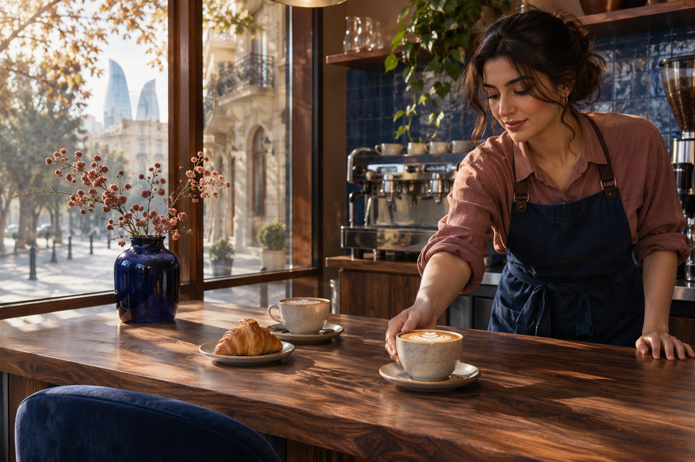

# Sahil Coffee

**AI-assisted vibe-coding portfolio project.** This fictional café concept was designed and built with AI assistance. It is not a commissioned client website or a live café.



**Live website:** https://sahil-coffee-house.xezernagmesi.workers.dev/

## About

An Azerbaijani-first coffee house website concept for Baku, with a custom emblem and five original AI-generated photographs.

- Responsive editorial design with subtle motion
- Interactive coffee and light-bites menu tabs
- Custom SVG emblem and matching favicon
- Accessible navigation, alt text, visible keyboard focus, and reduced-motion support
- React 19, TypeScript, Vite, TanStack Start, Cloudflare Workers

## Source

[Download the complete React project source](https://d2ol7oe51mr4n9.cloudfront.net/user_3M3PdWHrOkdokpbO7WSEDcFX6wU/2e886fec-88a4-47b3-828c-b493b42a9ff1.zip)

## Run locally

```sh
bun install
bun run dev
```

Build the static React site with `bun run build:static` (output: `static-dist/`).

## Demo note

This portfolio concept has no admin login, database, booking, ordering, or payment system. Menu prices, address, and opening hours are illustrative and should be replaced with verified information before real-world use.
